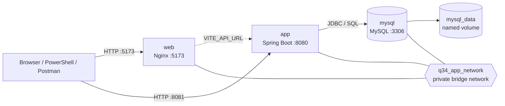
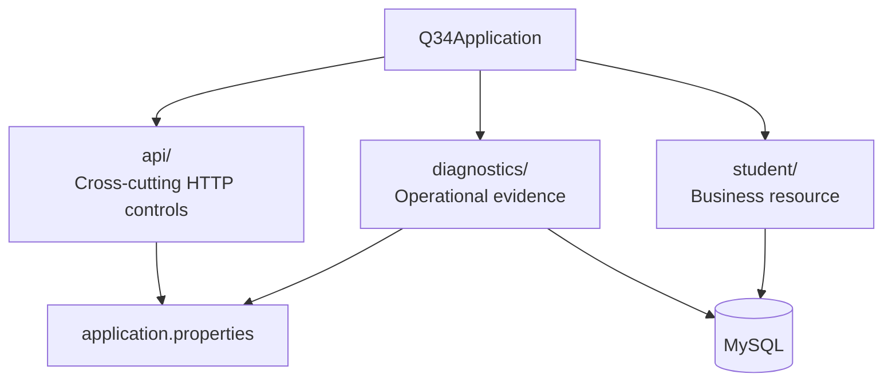
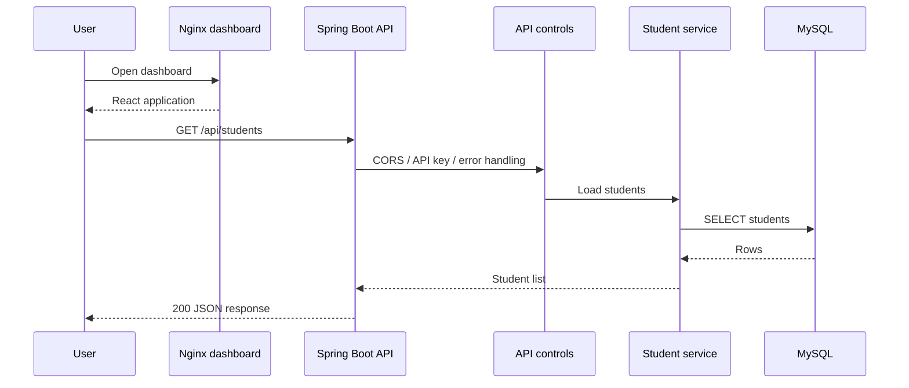
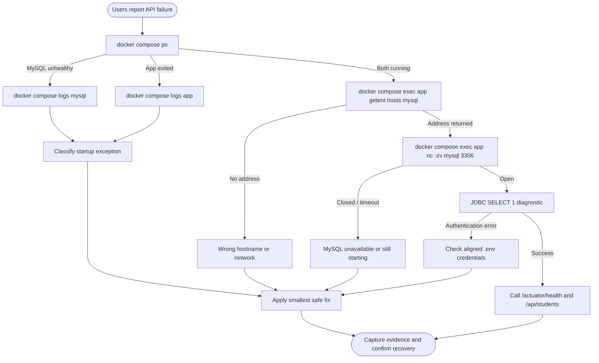
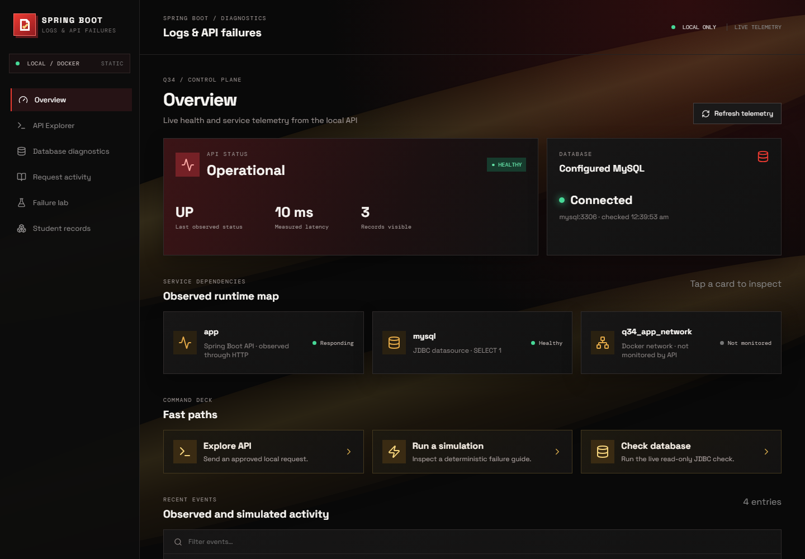
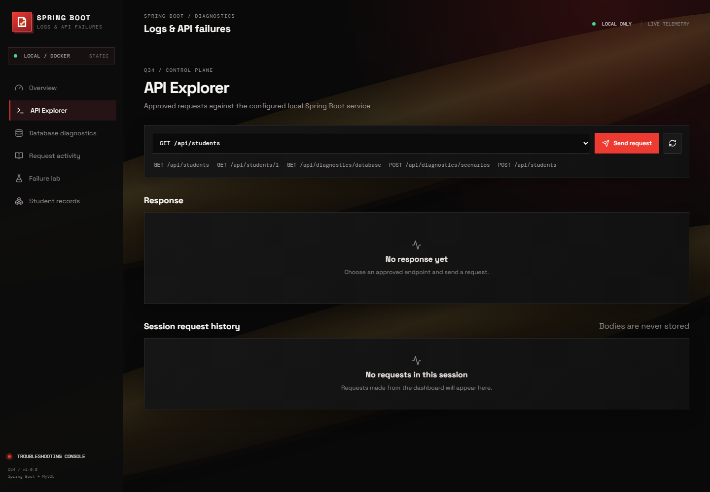
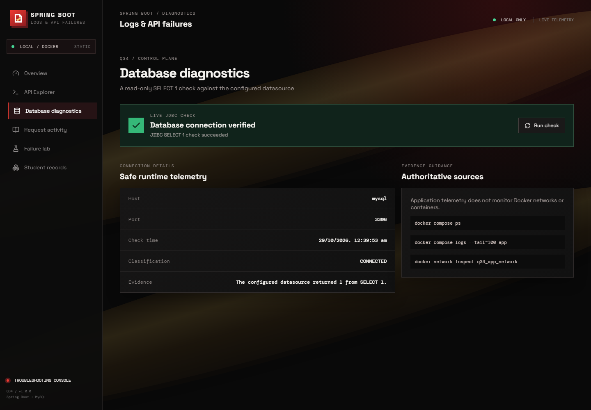
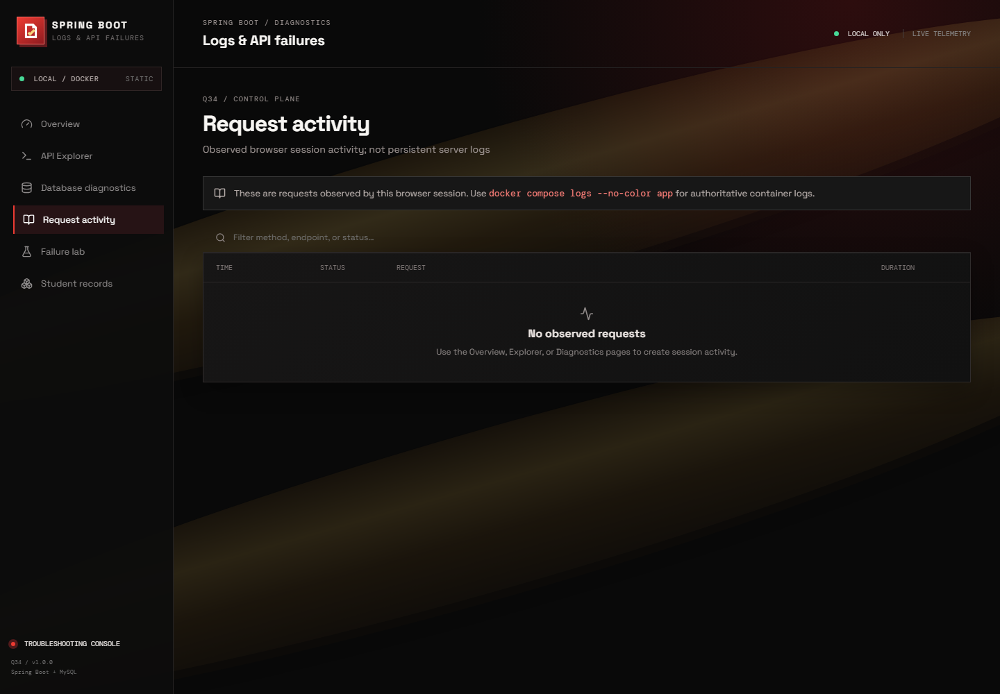
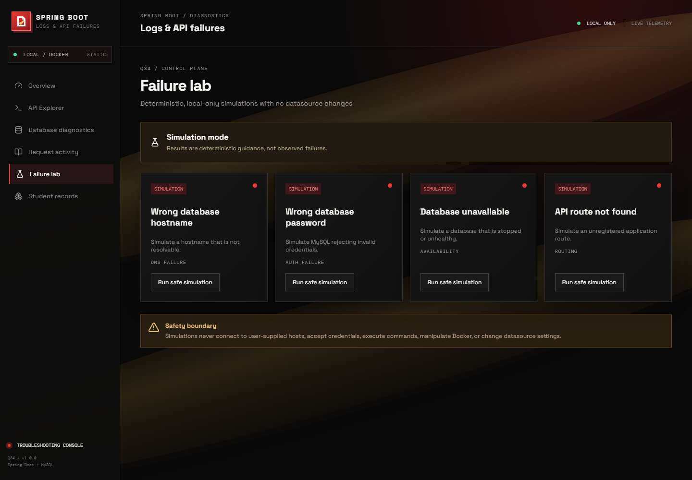
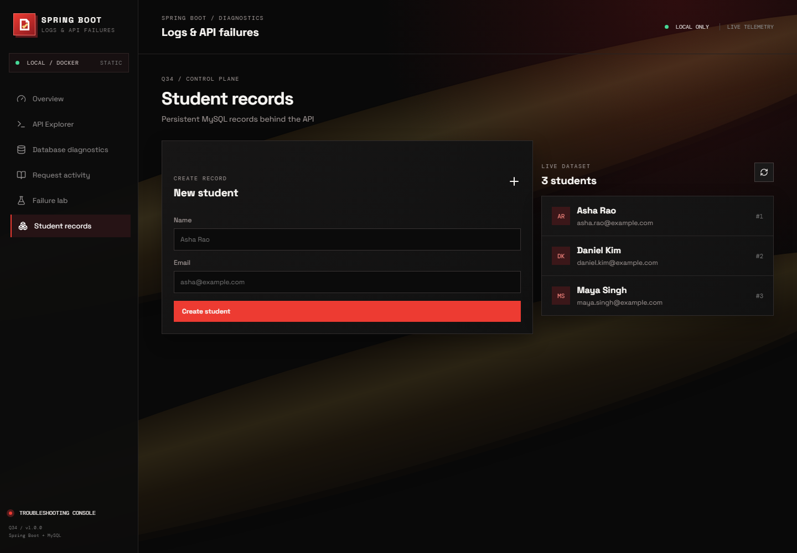

# Troubleshooting Spring Boot Logs and API Failures

> A hands-on Docker troubleshooting lab for Spring Boot, MySQL, and a
> read-only operations dashboard.

[](https://spring.io/projects/spring-boot)
[](https://openjdk.org/)
[](https://www.mysql.com/)
[](https://docs.docker.com/compose/)

This project recreates a realistic incident: users report that the student API
is failing, and the operator must distinguish a DNS problem, a TCP connection
problem, MySQL authentication failure, database startup delay, or an application
error. It includes a deliberately safe failure lab, reproducible Docker
commands, and an operations dashboard that never executes Docker commands or
accepts database credentials from the browser.

## What this repository provides

| Area | Capability |
|---|---|
| **Application** | Spring Boot REST API for student records |
| **Persistence** | MySQL 8.4 with a named volume and seed data |
| **Operations UI** | Vite/React dashboard for health, logs guidance, diagnostics, and API exploration |
| **Diagnostics** | JDBC `SELECT 1` check and deterministic simulated failure scenarios |
| **Troubleshooting lab** | Docker logs, DNS/TCP checks, authentication checks, controlled failures, and recovery |
| **Safety controls** | Explicit CORS origins, optional API key, diagnostic rate limiting, and no shell/Docker access from HTTP |

## Architecture at a glance



The host publishes the dashboard on `localhost:5173` and the API on
`localhost:8081` (mapped to port `8080` inside the app container). MySQL is
private to the Compose network. Inside Docker, the hostname is **`mysql`**;
`localhost` would incorrectly refer to the current container.

## Repository architecture

```text
.
├── compose.yaml                 # web, app, mysql, network, volume, healthcheck
├── Dockerfile                   # Java 25 multi-stage build and non-root runtime
├── README.md                    # Runbook, diagrams, scenarios, and evidence checklist
├── .env.example                 # Safe configuration template (copy to .env)
├── docs/
│   └── screenshots/              # Reproducible dashboard screenshots used below
├── frontend/
│   ├── Dockerfile               # Node build -> Nginx runtime image
│   ├── nginx.conf               # SPA fallback for React Router
│   ├── package.json              # Vite, React, Vitest, and UI dependencies
│   └── src/
│       ├── App.tsx              # Dashboard routes and operations views
│       ├── apiSecurity.ts       # Approved browser API surface
│       ├── apiSecurity.test.ts  # Frontend security tests
│       └── styles.css           # Dashboard visual system
├── src/main/java/com/example/q34/
│   ├── Q34Application.java      # Spring Boot entry point
│   ├── api/                     # CORS, API metadata, auth, rate limiting, errors
│   ├── diagnostics/             # Live DB check and simulated failure guidance
│   └── student/                 # Entity, repository, service, and REST controller
├── src/main/resources/
│   ├── application.properties  # Environment-driven Spring configuration
│   └── db/init.sql              # MySQL schema and sample records
└── src/test/                    # Spring MVC and controller tests
```

### Backend package organisation



## Request and diagnostic flows

### Normal student request



### Incident investigation flow



### Evidence boundaries

The checks intentionally prove different layers:

1. `docker compose ps` proves container state and the MySQL healthcheck result.
2. `docker compose logs app` and `docker compose logs mysql` explain startup and
   runtime failures.
3. `getent hosts mysql` proves Docker DNS resolution.
4. `nc -zv mysql 3306` proves TCP reachability from the app container.
5. The live diagnostics endpoint executes `SELECT 1` through the configured
   Spring datasource, proving application-level database access.
6. `/api/students` proves the schema, credentials, JPA mapping, and API path work
   together.

## Prerequisites

- Windows 10/11 with Docker Desktop running
- Java 25 and Maven (for local compilation)
- PowerShell
- Optional: curl (included with current Windows), Postman

## First-time setup (PowerShell)

Run these commands from the project directory:

```powershell
Copy-Item .env.example .env
notepad .env
```

Replace both password placeholders with local values. Use the same
`MYSQL_PASSWORD` for the application password; do not commit `.env`.

Compile without Docker:

```powershell
mvn -B clean test
```

Build and start both containers:

```powershell
docker compose up -d --build
docker compose ps
docker compose ps -a
```

`mysql` must become `healthy` before `app` is started. A running container only
means its process exists; it does not prove the API completed startup or can
authenticate to the database.

## Normal operation

The operations dashboard is available at `http://localhost:5173` after
`docker compose up -d --build`. It uses the real API on port 8081 and includes
overview telemetry, an API explorer, JDBC database diagnostics, log guidance,
safe failure-lab procedures, and persisted student records. The dashboard
never executes Docker commands or changes database credentials from the
browser; run the documented PowerShell commands yourself when reproducing a
container failure.

```powershell
curl.exe http://localhost:8081/
curl.exe http://localhost:8081/actuator/health
curl.exe http://localhost:8081/api/students
curl.exe http://localhost:8081/api/students/1
```

The API root returns a route summary. The interactive dashboard is served
separately at `http://localhost:5173`; opening the API root is not the
dashboard.

Expected list response (IDs can differ after a reset):

```json
[
  {"id":1,"name":"Asha Rao","email":"asha.rao@example.com"},
  {"id":2,"name":"Daniel Kim","email":"daniel.kim@example.com"},
  {"id":3,"name":"Maya Singh","email":"maya.singh@example.com"}
]
```

Create a student:

```powershell
$body = '{"name":"Noah Patel","email":"noah.patel@example.com"}'
curl.exe -i -X POST http://localhost:8081/api/students `
  -H "Content-Type: application/json" -d $body
```

The response is `201 Created`. The same request can be sent in Postman with
`POST http://localhost:8081/api/students` and the JSON body above.

## Interactive API explorer and safe diagnostics

The dashboard API Explorer at `http://localhost:5173/explorer` can call only
the approved local routes: `GET /api/students`, `GET /api/students/{id}`,
`POST /api/students`, and `GET /api/diagnostics/database`. It does not accept
arbitrary URLs, proxy requests through the server, or store request bodies.
POST bodies are parsed as JSON in the browser before submission.

The Failure lab uses `POST /api/diagnostics/scenarios` with only these enum
identifiers: `WRONG_HOST` (DNS/network), `WRONG_PASSWORD` (authentication),
`DB_UNAVAILABLE` (availability), and `API_NOT_FOUND` (routing). Every result
has `simulated: true` and is deterministic guidance; it is never evidence of
a real observed failure. The live database endpoint performs only `SELECT 1`
against the configured datasource and never exposes credentials or stack
traces.

Example scenario request:

```powershell
curl.exe -i -X POST http://localhost:8081/api/diagnostics/scenarios `
  -H "Content-Type: application/json" `
  -d '{"scenario":"WRONG_HOST"}'
```

For a publicly reachable deployment, set `APP_API_KEY` and send it as
`X-Local-Admin-Key` for diagnostics and student writes. Configure
`APP_CORS_ALLOWED_ORIGINS` with explicit trusted frontend origins. Diagnostic
requests are rate limited by `DIAGNOSTIC_RATE_LIMIT` and
`DIAGNOSTIC_RATE_WINDOW_SECONDS`. The application never accepts database
credentials or hosts from diagnostic requests, runs shell commands, accesses
the Docker daemon, or changes datasource settings.

## Q34 troubleshooting demonstration

### 1. Capture normal logs and container state

```powershell
docker ps
docker ps -a
docker compose logs --no-color app
docker compose logs --no-color mysql
docker network inspect q34_app_network
```

The network output should list both `q34-app-1` and `q34-mysql-1` (Compose
project names can vary). Do not paste passwords into screenshots or reports.

### 2. Test DNS and TCP/database connectivity from the application network

The production JRE image intentionally does not assume that `mysql` or `nc`
client tools are installed. First test service DNS from the app container:

```powershell
docker compose exec app getent hosts mysql
```

For a real MySQL protocol/authentication test, use a temporary diagnostic
container on the same Compose network. `MYSQL_PWD` prevents the password from
appearing in the command arguments:

```powershell
docker run --rm --network q34_app_network `
  -e MYSQL_PWD="$env:MYSQL_PASSWORD" mysql:8.4 `
  mysqladmin ping -h mysql -u "$env:MYSQL_USER" --silent
```

Successful output is `mysqld is alive`. If `getent` is unavailable in a custom
application image, the temporary container plus `docker network inspect` still
tests Docker DNS and TCP/MySQL authentication without modifying the app image.

### 3. Reproduce a controlled hostname failure

Stop the healthy app and run a one-off app with a deliberately invalid
hostname. This does not change `.env`, the image, or the database volume:

```powershell
docker compose stop app
docker compose run --rm --no-deps `
  -e SPRING_DATASOURCE_URL=jdbc:mysql://wrong-host:3306/studentsdb `
  app
```

In another PowerShell window, while that command is running or after it exits:

```powershell
curl.exe -i http://localhost:8081/api/students
docker compose logs --no-color app
```

The request fails because no healthy application is listening. The Spring log
contains an unknown-host/connection error for `wrong-host`. This demonstrates
why "container is running" is not the same as "application is ready".

For an authentication failure instead, use the correct URL but a wrong
password:

```powershell
docker compose run --rm --no-deps `
  -e SPRING_DATASOURCE_PASSWORD=definitely-wrong `
  app
```

The log then shows an access-denied authentication error. A database-not-ready
failure generally occurs before the healthcheck becomes `healthy`; a Spring
startup failure is shown by an application exception and an exited app
container. Distinguish these from a connection failure (DNS/TCP) and an
authentication failure (MySQL rejects valid TCP credentials).

### 4. Fix and verify

```powershell
docker compose up -d app
docker compose ps
docker compose logs --no-color --tail=100 app
curl.exe http://localhost:8081/api/students
```

The list response proves that the hostname, credentials, schema, and JPA
startup are working again.

## Troubleshooting table

| Symptom | Diagnostic command | Expected evidence | Root cause | Fix | Verification |
|---|---|---|---|---|---|
| App exits during startup | `docker compose ps -a`; `docker compose logs app` | Non-zero exit and Spring datasource exception | Invalid URL, credentials, or schema | Correct `.env` / datasource settings | `docker compose ps` shows app running; API returns 200 |
| `wrong-host` cannot resolve | `docker compose logs app`; `docker compose exec app getent hosts mysql` | Unknown-host error; `mysql` resolves | Wrong database hostname | Use `mysql`, not `localhost` or `wrong-host` | Restart app and call `/api/students` |
| Access denied | `docker run ... mysqladmin ping ...` and app logs | MySQL access-denied message | Username/password mismatch | Align `.env` values and recreate DB only if credentials were initialized incorrectly | Health ping and API both succeed |
| Connection refused/timeouts | `docker compose ps`; `docker network inspect q34_app_network` | MySQL not healthy or absent from network | DB still starting or network mismatch | Wait for healthcheck; use Compose network | `mysql` is `healthy`; app starts |
| Empty/old sample data | `docker volume ls`; `curl .../api/students` | Volume contains previous state | Named volume preserves data | `docker compose down -v` only for a deliberate reset | Seed rows return after `up --build` |

## Safe reset and shutdown

Recreate containers while preserving MySQL data:

```powershell
docker compose up -d --force-recreate app
```

Stop containers without deleting data:

```powershell
docker compose down
```

Destructive reset (deletes the named volume and all database data):

```powershell
docker compose down -v
docker compose up -d --build
```

## Five-to-seven-minute presentation script

1. **0:00-0:45** — State the problem: users report `/api/students` failing.
   Show the two Compose services and the private application network.
2. **0:45-1:30** — Run `docker compose ps`, health, and the successful curl
   request. Explain that the sample rows come from MySQL initialization SQL.
3. **1:30-2:15** — Show `docker compose logs app` and `docker compose logs
   mysql`; point out startup order and the MySQL healthcheck.
4. **2:15-3:15** — Run `docker compose exec app getent hosts mysql`, then the
   temporary `mysql:8.4` diagnostic container. Explain DNS, TCP, and why a
   MySQL client is not assumed in the JRE image.
5. **3:15-4:30** — Stop `app`, run the `wrong-host` failure command, and show
   the failed curl plus the Spring log. Explain that a container/process can
   exist without a ready API.
6. **4:30-5:30** — Explain the difference between DNS/TCP connection,
   authentication, database-not-ready, and application startup failures.
7. **5:30-6:30** — Run `docker compose up -d app`, call the API again, and show
   the successful response. Mention that `mysql_data` survives app recreation.
8. **6:30-7:00** — Show the screenshot checklist and remind the audience that
   `.env` contains local secrets and is ignored by Git.

## Screenshot checklist

- [ ] `docker compose ps` showing MySQL healthy and app running
- [ ] Successful `/actuator/health` response
- [ ] Successful `/api/students` response with sample rows
- [ ] `docker compose logs app` during normal startup
- [ ] `docker compose logs mysql` showing database readiness
- [ ] `docker network inspect q34_app_network` showing both services
- [ ] `docker compose exec app getent hosts mysql`
- [ ] Temporary `mysqladmin ping` success (without showing a password)
- [ ] Controlled failure curl and relevant Spring error log
- [ ] Recovery API response
- [ ] `docker volume ls` showing the named volume

## Limitations and reproducibility notes

The initialization SQL runs only when the MySQL data directory is empty.
Changing `.env` credentials after the first start does not rewrite existing
database users; use `docker compose down -v` only when a clean local reset is
acceptable. No real credentials belong in this repository.

## Dashboard screenshots

The screenshots below were captured from the running Docker deployment after
the frontend and API became healthy. They are stored in
[`docs/screenshots/`](./docs/screenshots/) so the gallery remains available in
the GitHub repository and does not depend on a local `localhost` URL.

### Operations overview

The overview combines API health, observed latency, visible student records,
and the live MySQL connection state in one operator-friendly view.



### API explorer

The API Explorer provides a constrained interface for approved local routes
without becoming an arbitrary URL proxy.



### Database diagnostics

The database diagnostics view reports the configured host and port and performs
the application-level JDBC `SELECT 1` check without exposing credentials or
stack traces.



### Request activity

Request activity is intentionally scoped to the current browser session. The
page also points operators to Docker logs as the authoritative source for
server-side evidence.



### Failure lab

The Failure lab presents deterministic, local-only simulations for DNS,
authentication, database availability, and routing failures. Simulations do
not modify datasource settings or execute commands.



### Student records

Student records demonstrates the end-to-end persistence path from the React
dashboard through Spring Boot and JPA to MySQL.


